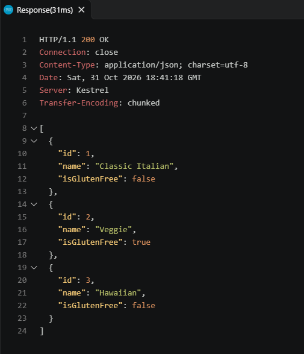

# W01 Assignment

## 🍕 1. ASP.NET Core Pizza API Evidence

Evidence from the end of the _Create a web API with ASP.NET Core controllers_ module, showing the existing pizzas and the additional pizza.

### 📋 Existing & Additional Pizza



---

## 🚀 2. API Operations Log (CRUD)

Here are the exact details for each HTTP request sent and response received during testing.

### 🔍 GET - Retrieve All Pizzas

- **Request Sent:** `GET http://localhost:5206/pizza`
- **Status Code:** `200 OK`
- **Response Received:**
  ```json
  [
    {
      "id": 1,
      "name": "Classic Italian",
      "isGlutenFree": false
    },
    {
      "id": 2,
      "name": "Veggie",
      "isGlutenFree": true
    },
    {
      "id": 3,
      "name": "Hawaii",
      "isGlutenFree": false
    }
  ]
  ```

### ➕ POST - Add New Pizza

- **Request Sent:** `POST http://localhost:5206/pizza`
  - **Body:**
    ```json
    {
      "name": "Hawaii",
      "isGlutenFree": false
    }
    ```
- **Status Code:** `201 Created`
- **Response Received:**
  ```json
  {
    "id": 3,
    "name": "Hawaii",
    "isGlutenFree": false
  }
  ```

### 🔄 PUT - Update Existing Pizza

- **Request Sent:** `PUT http://localhost:5206/pizza/3`
  - **Body:**
    ```json
    {
      "id": 3,
      "name": "Hawaiian",
      "isGlutenFree": false
    }
    ```
- **Status Code:** `204 No Content`
- **Response Received:** _(Empty Body)_
  ```http
  HTTP/1.1 204 No Content
  Connection: close
  Date: Sat, 31 Oct 2026 18:36:37 GMT
  Server: Kestrel
  ```

### ❌ DELETE - Remove a Pizza

- **Request Sent:** `DELETE http://localhost:5206/pizza/3`
- **Status Code:** `204 No Content`
- **Response Received:** _(Empty Body)_
  ```http
  HTTP/1.1 204 No Content
  Connection: close
  Date: Sat, 31 Oct 2026 18:47:23 GMT
  Server: Kestrel
  ```

---

## 📊 3. Sales Summary Function

Below is the working sales summary function from the _Work with files and directories in a .NET app_ module.

```csharp
string BuildSalesSummary(IEnumerable<string> salesFiles)
{
    StringBuilder salesSummary = new StringBuilder();
    StringBuilder salesDetail = new StringBuilder();
    string header = "Sales Summary";
    string divider = "----------------------------";

    salesSummary.AppendLine(header);
    salesSummary.AppendLine(divider);

    double salesTotal = 0;

    // Loop over each file path in salesFiles
    foreach (var file in salesFiles)
    {
        FileInfo info = new FileInfo(file);
        if (!info.Name.Equals("sales.json", StringComparison.OrdinalIgnoreCase))
        {
            continue;
        }
        // Read the contents of the file
        string salesJson = File.ReadAllText(file);
        // Parse the contents as JSON
        SalesData? data = JsonConvert.DeserializeObject<SalesData?>(salesJson);

        // Add the amount found in the Total field to the salesTotal variable
        salesTotal += data?.Total ?? 0;
        Console.WriteLine(info.Directory.Name);
        var relativePath = Path.Combine(info.Directory.Name, info.Name);
        Console.WriteLine(relativePath);
        salesDetail.AppendLine($"  {relativePath}: {(data?.Total ?? 0):C}");
    }

    salesSummary.AppendLine($" Total Sales: {salesTotal:C}");
    salesSummary.AppendLine("");
    salesSummary.AppendLine($" Details:");
    salesSummary.Append(salesDetail.ToString());

    return salesSummary.ToString();
}

```
